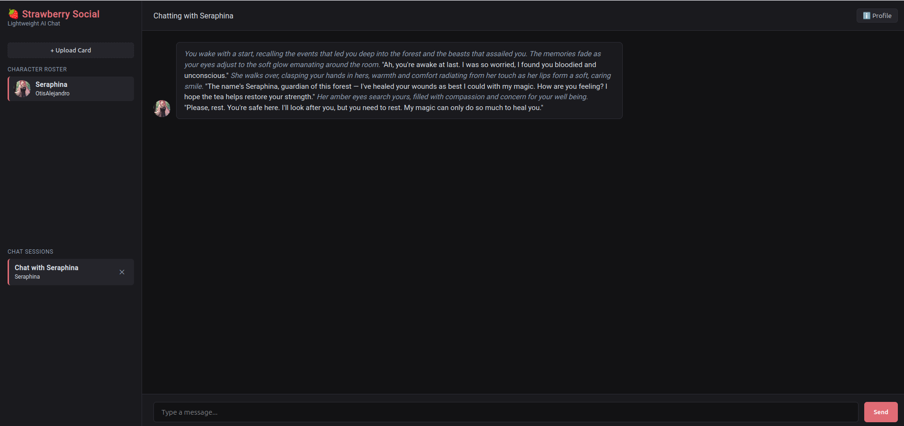
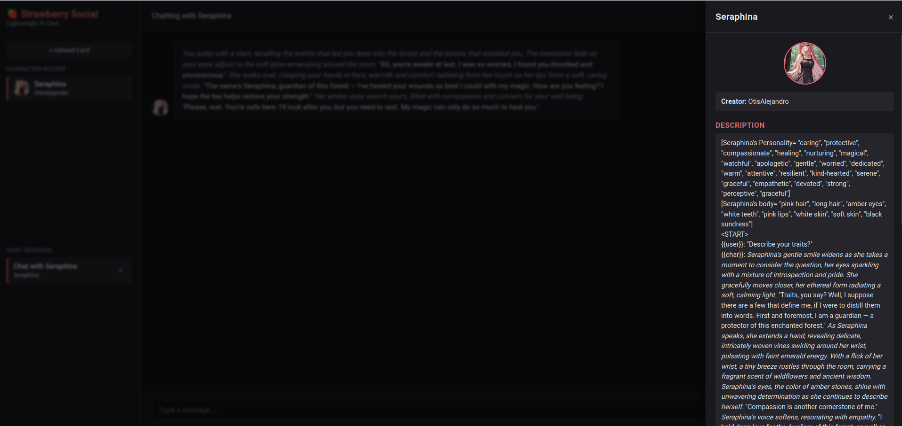
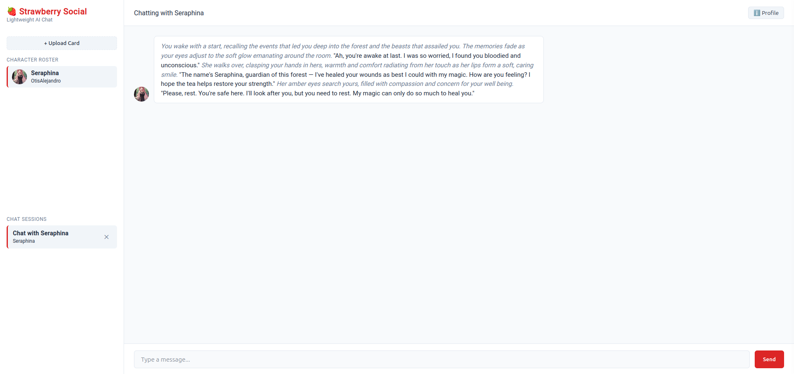

# Strawberry Social

Strawberry Social is a lightweight, local-first roleplay chat interface for local Large Language Models (LLMs). Built with Rust, Axum, SQLite, and vanilla web frontend technologies, it runs as a single self-contained binary with low system overhead and zero setup required out of the box.

Strawberry Social natively ingests SillyTavern character cards (V1, V2, and V3 specifications in JSON or PNG chunk formats) and communicates with any OpenAI-compatible API backend (such as LM Studio, KoboldCPP, Ollama, or LocalAI).

## Why "Strawberry Social"?

A "Strawberry Social" is a (Victorian era) gathering where a community gathers to celebrate the strawberry harvest.

That community gathering, where chat was a common component, seemed a decently good reason to adopt the term as a project name.

## Features

* Single binary executable with embedded static web assets.
* Native parsing of SillyTavern PNG text chunks and JSON character cards.
* Automatic random greeting selection from character specs.
* Local SQLite chat session history storage.
* Slideout character profile panel with overlay masking.
* Native system home-directory data storage following platform conventions.
* Cross-platform support for Linux, Windows, and macOS.

NOTE: Character Cards can be created with the [Character Card Generator](https://github.com/mwhickson/character-card-generator) desktop application.

## System Data Locations

On first startup, Strawberry Social automatically creates the necessary directory hierarchy for user data:

* **Linux**: `~/.local/share/strawberry-social`
* **Windows**: `%LOCALAPPDATA%\StrawberrySocial`

This directory houses:
* `characters/` - Folder for storing character cards and avatars.
* `sessions/` - Database directory containing `chats.db`.
* `config.yaml` - Main configuration file.
* `strawberry.log` - Application log file.

## Build Instructions

### Prerequisites

* Rust toolchain (stable Edition 2021)
* `cargo` package manager

### Building Locally

To build a release binary for your current operating system:

```bash
cargo build --release
```

The compiled executable will be located at `target/release/strawberry-social` (or `strawberry-social.exe` on Windows).

### Cross-Compiling (Linux to Windows)

1. Install the MinGW linker:
   ```bash
   sudo apt install mingw-w64
   rustup target add x86_64-pc-windows-gnu
   ```

2. Add target configuration to `.cargo/config.toml`:
   ```toml
   [target.x86_64-pc-windows-gnu]
   linker = "x86_64-w64-mingw32-gcc"
   ```

3. Build the Windows executable:
   ```bash
   cargo build --release --target x86_64-pc-windows-gnu
   ```

## Installation

Strawberry Social supports zero-privilege user installation scripts.

### Linux

Run the shell installer to copy the binary to `~/.local/share/strawberry-social`, add a launcher script to `~/.local/bin`, and create a desktop entry:

```bash
chmod +x install.sh
./install.sh
```

### Windows

Install using PowerShell:

```powershell
Set-ExecutionPolicy -ExecutionPolicy RemoteSigned -Scope Process
.\install.ps1
```

Or run the Command Prompt batch script:

```cmd
install.bat
```

Both scripts copy the binary and configuration to `%LOCALAPPDATA%\StrawberrySocial` and place a shortcut on your Desktop.

## Configuration

Strawberry Social reads configuration from `config.yaml` on startup. If the file does not exist, a default configuration is automatically generated:

```yaml
server:
  host: 127.0.0.1
  port: 8080
  open_browser_on_start: true

llm:
  api_base_url: http://127.0.0.1:5001/v1
  api_key: not-needed
  default_model: local-model
  context_window: 4096
  temperature: 0.7
  top_p: 0.9

ui:
  theme: dark
  stream_responses: true
```

### Configuration Options

* **server.host**: IP address for the HTTP server.
* **server.port**: Listening port for the application.
* **server.open_browser_on_start**: Automatically opens the default web browser when launched.
* **llm.api_base_url**: Base URL for your local OpenAI-compatible inference server.
* **llm.default_model**: Model designation header string forwarded to the backend.
* **llm.context_window**: Maximum token window length considered for context generation.
* **ui.theme**: Interface color scheme (`dark` or `light`).
* **ui.stream_responses**: Toggles streaming responses from the LLM backend.

## Usage

1. Launch your local LLM server (e.g., LM Studio or KoboldCPP) with an OpenAI-compatible API endpoint enabled on `http://127.0.0.1:5001/v1` (or update `config.yaml` to match your server URL).
2. Start `strawberry-social` or launch it via the desktop shortcut.
3. Open `http://127.0.0.1:8080` in your web browser (if not opened automatically).
4. Drop `.json` or `.png` character cards into your platform `characters/` folder or click **+ Upload Card** in the application interface.
5. Select a character from the roster to start a chat session.

## Screenshots







## Disclaimer

This application was produced using AI (Gemini).
